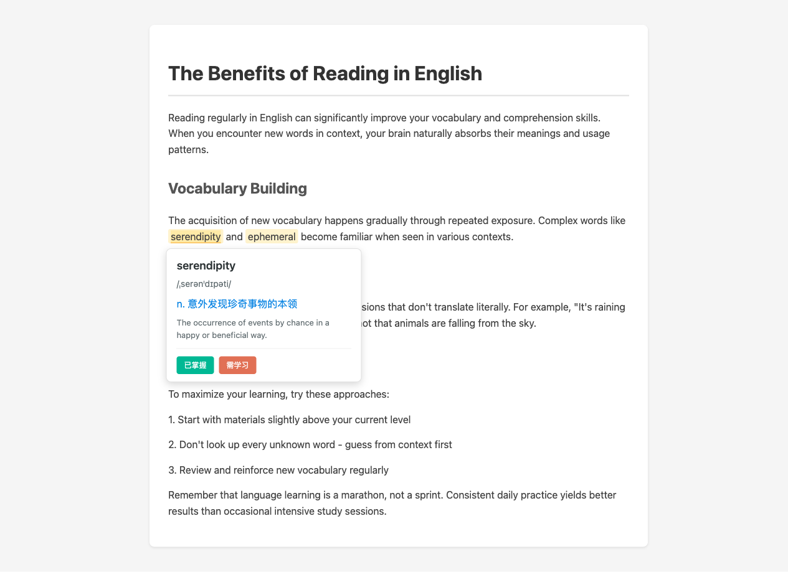

# NotOnlyTranslator

**智能英语阅读助手 - 只翻译你不会的词**

[](LICENSE)

面向英语学习者的 Chrome / Edge 扩展（Manifest V3）。它按考试水平或测评结果，以及你标记过的已知词、生词，筛出候选难词并给出中文释义，同时尽量保留英文阅读。阅读方式有行内释义、双语对照和全文翻译。支持流式响应的服务会在每一段结果完整到达后立即展示。

常用词优先查随扩展提供的词典和已有缓存；未收录，或需要语境释义、短语、语法、全文时，才调用你选中的服务。

> 安装包从 [GitHub Releases](https://github.com/davisjiahao/notOnlyTranslator/releases) 下载，或自行构建后以开发者模式加载。此发布不提交 Chrome 应用商店，扩展也未在商店上架。词典命中不代表整页阅读离线；选择云端或联网翻译后，相应文本会发到该服务。

当前版本 **0.4.1**。

---

## 界面预览



*示意图，不代表对任意网站的实际识别结果。阅读流程：打开英文页面 → 高亮候选难词 → 点击查看释义 → 标记已知或生词。*

---

## 功能与边界

| 功能 | 当前实现 |
| --- | --- |
| 分级阅读 | 用考试分数或 20 题测评估计词汇量，再结合已知词、生词标记筛选和高亮候选词。自动判断不保证覆盖每一个陌生词。 |
| 三种阅读模式 | 行内在难词后给出释义；双语在英文段落下给出整段中文；全文以中文为主并保留难词的英文原词。可按设置补充短语和语法说明。短语与语法增强默认开启。 |
| 模式切换 | 取消在途请求并丢弃不再适用的缓存，立刻清掉当前译文和已有词义，再按新模式重新获取可见段落，包括双语和全文。浮动按钮显示正在重新获取；正文不做透明度闪动。 |
| 高亮 | 在拼接后的可译正文上定位。同一词的每次出现都会标记；被行内标签拆开的词按整词标记，已有标记内不再嵌套。 |
| 语言判断 | 取样前去掉扩展自己的中文界面。短页面整段判断。短英文不会因语言声明、全角标点或少量汉字被当成中文页跳过。 |
| 查词浮层 | 点击或悬停难词查看释义，并可标记已知或生词。浮层分开显示正在翻译、翻译失败和翻译已取消。 |
| 逐段显示与刷新 | 支持 SSE 的批次在单段校验通过后提前显示。刷新页面时可复用仍有效的缓存，或加入同一任务里仍在运行的后台批次。切换模式、词表、翻译配置或 API 密钥会取消在途任务并丢弃旧缓存。 |
| 学习记录 | 生词筛选、闪卡复习、掌握度估算和翻译历史。闪卡在确认前可改评分，保存失败可重试；确认后的评分不能在复习页回滚。统计使用当前词条快照和已保存的时间，不补造缺失的学习历史。 |
| 界面 | 阅读优先的弹窗、分组设置和窄屏导航；高亮与浮层可键盘操作并归还焦点；支持明暗主题和系统减少动画偏好。 |
| 翻译服务 | 云端模型、OpenAI 兼容自定义端点、本机 Ollama，以及 DeepL、有道、Google 翻译。云端请求可能计费。请自行保管 API 密钥。 |

---

## 安装

### 从发布包安装

1. 从 [GitHub Releases](https://github.com/davisjiahao/notOnlyTranslator/releases) 下载 `notOnlyTranslator-v*.zip`，解压到一个固定目录。
2. 打开 `chrome://extensions/`（Edge 为 `edge://extensions/`），开启**开发者模式**。
3. 点击**加载已解压的扩展程序**，选择解压后包含 `manifest.json` 的目录。

### 从源码安装

需要 Node.js **20.19.0 或更新版本**（建议使用仍在维护的 LTS）、npm，以及 Chrome 或 Edge。

```bash
git clone https://github.com/davisjiahao/notOnlyTranslator.git
cd notOnlyTranslator
npm install
npm run build
```

1. 打开 `chrome://extensions/`；Edge 使用 `edge://extensions/`。
2. 开启**开发者模式**，点击**加载已解压的扩展程序**，选择生成的 `dist` 文件夹。
3. 将扩展固定到工具栏，便于打开设置和切换阅读方式。

**更新已有安装：**更新源码后重新运行 `npm run build`，在扩展管理页点击**重新加载**，再刷新已经打开的阅读页面。只替换磁盘上的文件，已打开页面里的内容脚本仍是旧版本。

### 首次配置

1. **选择翻译方式。**基础单词查询先走本地词典，命中时不需要 API 密钥或网络。需要模型增强时，打开扩展图标中的设置，选择提供商并测试连接。云端服务按该服务的要求填写密钥；本机 Ollama 默认可留空。翻译尚未配置、且引导未跳过时，弹窗和设置页会显示欢迎引导。
2. **设置英语水平。**选择考试类型和分数，或完成 20 题快速测评。
3. **开始阅读。**打开英文网页后会高亮候选难词，点击即可查看释义并标记。四个阅读操作带有默认快捷键；弹窗快捷键可在 `chrome://extensions/shortcuts` 自行绑定。

| 快捷键 | 作用 |
| --- | --- |
| Alt+T | 翻译当前段落 |
| Alt+Shift+T | 显示或隐藏已有译文；页面上还没有译文时，翻译当前段落 |
| Alt+F | 翻译当前页面 |
| Alt+I | 在行内和双语之间切换，并按新模式重新获取 |

全文模式从浮动按钮或弹窗选择。Alt+I 只在行内和双语之间往返。

---

## 阅读模式

| 模式 | 阅读效果 |
| --- | --- |
| 行内 | 保留英文，在识别出的难词后直接展示中文释义。 |
| 双语对照 | 保留英文段落，在其下方展示完整中文译文。 |
| 全文翻译 | 以中文译文为主，同时保留难词的英文原词。 |

可从页面浮动按钮或扩展弹窗切换。切换后页面不刷新，顺序是：

1. 取消尚未完成的翻译，并丢弃该阅读上下文下不再适用的缓存。
2. 立刻清掉页面上的词义和旧译文。
3. 大约 150 毫秒后重新扫描，并按新模式获取当前可见段落。双语和全文都会重新请求对应结果。
4. 浮动按钮在重新获取期间显示状态，例如「正在按对照模式重新获取译文」；有批次进行时按钮文字为「翻译中…」。
5. 正文保持可见，透明度不变。

查词浮层在请求期间显示「正在翻译」，失败时显示失败原因并提供重试，取消时显示「翻译已取消」。

某次返回的双语或全文结果如果缺少完整段落译文，页面会保留原文和已有词义，并说明暂无全文。模式切换会先清掉这些词义，再按新模式重新获取。

更换服务、词表、短语或语法开关、API 密钥，或网页正文发生变化，也会取消在途任务并重新获取。只改高亮颜色、字号等外观时，不因此丢弃译文。

### 逐段展示、限流与刷新

- **按批请求，按段显示。**一批可以包含多个段落。每段的全文、词义和已启用的语法分析完整到达并通过校验后立即展示，不等待整批结束，也不逐字刷新半截 JSON。
- **流式取决于服务。**OpenAI 兼容接口（含走该接口的 Ollama）、Anthropic 和 Gemini 可以消费 SSE。服务忽略流式参数、只返回普通 JSON 时，仍接受完整响应，但要等整段完成。百度文心走原生 JSON。
- **取消、超时和 429。**停用翻译、切换模式或变更影响结果的配置时，在途请求会被取消。单次请求有截止时间；源站返回 429 后，后续请求会等待冷却。错误提示不回显密钥或凭据。
- **刷新可以复用未失效的结果。**同一翻译任务仍在后台运行时，新页面可加入该任务，重放已完成段落并继续接收后续结果。正文、服务、词表、模式或其他影响结果的配置变化，缓存过期或被清理，以及浏览器重启、后台 Service Worker 被回收，都需要重新请求。刷新页面本身不取消仍在运行的后台批次。

Ollama 单次翻译请求默认限时 90 秒，后台翻译消息整体预算 120 秒。连接测试不受这条单次翻译超时约束。

---

## 高亮与语言判断

阅读高亮在段落拼接后的可译正文上定位，包含被行内标签拆到后面节点里的文字。因此：

- 同一个词出现多次时，每一次都会标记。
- 单词被 `<em>`、`<a>` 等行内标签拆开时，按拼接后的整词定位，再分段包裹。
- 已经落在高亮内的区间不会再套一层标记。

判断页面语言之前，会先去掉扩展注入的浮动按钮、帮助面板、查词浮层和译文。短样本整段参与判断，避免采样窗口正好落在界面中文上。短英文即使带有中文语言声明、全角标点或很少的汉字，仍按英文页处理。段落级跳过同样只统计汉字；汉字很少时，不按中文比例跳过该段。

编辑区、表单和部分导航会被跳过，以减少误翻译，也避免把正在输入的内容送出页面。

---

## Jev 实验生词识别

默认关闭。入口在 **API 设置 → Jev 词汇评估**。选择识别供应商，填写完整 HTTPS API URL、模型和阈值，先保存配置，再保存该服务的密钥、测试连接并启用。TypeSafe 是默认预设，地址为 `https://api.typesafe.ai/v1/systemone`。自定义服务必须兼容 **Jev `systemone/noul` 协议**，不能直接填写 OpenAI 聊天接口。

只有下面条件同时成立时，Jev 才会参与自动阅读识别：

- 当前估算等级为 **B1**
- 阅读模式为 **行内**
- **短语增强和语法增强都关闭**（这两项默认是开启的）
- 混合路由关闭，且释义服务是 OpenAI、Anthropic、Gemini、Ollama 或 OpenAI 兼容自定义服务

任一条件不满足时，设置页会写明原因，阅读继续使用原来的识别流程。手动查词保持原有行为。识别失败且本次任务仍有剩余时间时，会回退原流程一次；超时或取消后不再补发。

开启后，待判断的句子和目标词位置会发到已保存的识别地址；入选词再由当前翻译模型补充语境释义。常见词也按语境判断，同一个词的不同出现位置分别处理。

密钥只保存在本机扩展的 IndexedDB 中，并绑定供应商和完整 HTTPS 地址。同步设置和普通备份都不包含它。更换供应商或地址后要重新保存对应密钥。「清除全部数据」会删除该密钥。扩展按原文字符串保存这份记录，没有再加密。

地址不能包含用户名、密码、查询参数或片段。首次启用或测试时，按当前主机申请站点权限（TypeSafe 预设为 `https://api.typesafe.ai/*`）。

默认模型 `jev-1.13.0`、阈值 `0.26` 来自冻结的合成样本，不是对自然文章识别质量的保证。更换地址、供应商、模型或阈值后不再沿用该校准，界面会提示重新评估。阈值越低，入选词越多；连接成功只说明接口可用。实验数据未经教师认证。冻结结果与运行命令见 [评估说明](scripts/jev-evaluation/README.md)。

---

## 本地词典与 Ollama

- **基础查询：**优先复用匹配语境的生词本释义和缓存，再查随扩展提供的 17,404 条常用及考试词条。词典包含常见屈折变化，返回的是通用义项，不能保证消解一词多义。
- **自动筛词：**已知词、未知词和 CEFR 等级在本地参与筛选。轻量词汇模式由本地确定候选词、难度和位置，模型只补充中文释义。短语、语法和全文仍走对应的增强流程。
- **离线边界：**单词查词命中本地词典时可以不调用翻译 API。整段免请求只发生在行内模式、短语和语法增强都关闭、且所有候选词都有本地释义时。默认开启短语和语法增强。未配置密钥时不会自动改用 Google 翻译；未命中时可能提示配置服务。明确选择免费 Google 翻译后需要联网，其全文可用于双语和全文；仅行内模式不会发出这种只返回全文的请求，并会提示改用双语或全文。

### 配置本机 Ollama

1. 启动 Ollama，在扩展 API 设置中选择 **Ollama 本地模型**。
2. 默认地址可留空，此时使用 `http://localhost:11434/v1/chat/completions`。自定义地址必须是**完整聊天端点**，扩展不会自动补路径。本机默认服务不需要 API 密钥。
3. 选择已安装的模型并测试连接。CPU 机器可从 `qwen3:4b` 开始实测速度和效果。基础查词不需要安装模型。

翻译走 OpenAI 兼容接口，请求会尝试关闭思考，并在适用时要求 JSON 输出；模型是否支持取决于该模型本身。

### 词典来源

词条来自 [ECDICT](https://github.com/skywind3000/ECDICT)，筛选 BNC/词频前 15,000，或带 CET4、CET6、高考、考研标签且含中文释义的英文词。许可证保留于 [`src/data/ECDICT-LICENSE`](src/data/ECDICT-LICENSE)，构建产物也携带 `ECDICT-LICENSE`。

日常 `npm run build` 使用仓库内的 JSON，不需要下载原始词典。维护词库时运行（已在 Node 25 验证；使用现有环境代理）：

```bash
node --use-env-proxy scripts/buildOfflineDictionary.ts
```

生成器保存来源、筛选规则、源文件及产物 SHA-256。上游内容与已记录哈希不同时，会拒绝静默覆盖；更新前须审查来源与许可证。

---

## 学习记录

设置页提供生词本、到期闪卡和从生词本选出的手动复习。闪卡为 1–5 分自评：确认前可以改选或撤销本题评分；保存失败时保留当前题并可以重试。确认保存后，该评分不能在复习页回滚。跳过的词不计入本轮结果。没有到期记录只说明当前没有到期项，不代表全部词汇已掌握。

学习统计展示当前词条快照，以及已保存的保存时间和最近一次复习时间，不把缺失的复习补成连续天数、学习时长或增长率。翻译历史保存在本机 IndexedDB，最多 1,000 条，并清理超过 30 天的记录。

---

## 隐私与备份

词典和用户记录放在扩展本地或浏览器同步存储。翻译历史和 Jev 密钥使用各自的本机 IndexedDB。

- 同步存储包含用户档案、设置和翻译服务密钥。
- 本机存储包含已知词、未知词、掌握度和翻译缓存。
- Jev 密钥只在本机 IndexedDB，并绑定供应商和完整 HTTPS 地址；导出和同步都会剔除它。
- 备份可能包含翻译服务的 API 密钥。不要公开分享备份，也不要在敏感页面启用联网翻译。
- 导入设置可能改变翻译服务和联网范围，导入后请检查提供商与模式。
- 为避免备份把页面文本送到未知地址，备份中的自定义服务端点（含本机地址）不会导入。需要时在设置页重新填写。
- 清除全部数据会删除 Jev 密钥，以及同步和本机中的用户数据。

---

## 适用范围

适合在普通英文网页上辅助理解词汇。专业术语、语境多义词和复杂页面布局需要自行核对。自动高亮是候选结果，不是完整的词汇诊断。

---

## 开发与验证

```bash
npm test             # 单元与集成测试
npm run lint         # ESLint，不允许警告
npm run type-check   # TypeScript
npm run build        # 类型检查并构建扩展
# 统计 src 下全部 TS/TSX 文件的覆盖率
npx vitest run --coverage --coverage.include='src/**/*.{ts,tsx}'
```

端到端测试需事先安装 Playwright 浏览器：

```bash
npx playwright install chromium

# 本地优先阅读的隔离用例，不调用付费模型服务
npx playwright test --config=e2e/local-first.config.ts

# Jev 凭据、精确词位、取消及设置界面的隔离用例
npx playwright test --config=e2e/jev.config.ts

# 流式显示、刷新复用、模式切换及翻译展示的定向回归
npx playwright test --config=e2e/local-first.config.ts \
  batch-streaming.spec.ts mode-switching.spec.ts \
  llm-translation-display.spec.ts github-like-reading.spec.ts
```

隔离测试使用真实扩展链路和受控 HTTP 响应，核对段落可见性、刷新后的文档身份和后台请求次数。它们不能替代真实提供商、个人浏览器配置和任意网站的验收。`npm run test:e2e` 使用另一套默认配置，可能访问外部网站，运行前请核对配置。

---

## 技术栈

<details>
<summary>点击展开</summary>

- **界面：**React 18、TypeScript、Tailwind CSS、Zustand
- **扩展构建：**Vite、@crxjs/vite-plugin、Chrome Extension Manifest V3
- **浏览器存储：**`chrome.storage` 同步/本机，以及 IndexedDB（翻译历史、Jev 密钥）
- **模型与翻译接口：**OpenAI、Anthropic、Gemini、Groq、DeepSeek、智谱、阿里通义、百度文心、Ollama、OpenAI 兼容自定义端点、DeepL、Google 翻译、有道
- **离线词库：**ECDICT 筛选子集

</details>

---

## 贡献

欢迎报告问题、修正文档或提交代码。

1. Fork 本仓库
2. 创建特性分支（`git checkout -b feature/AmazingFeature`）
3. 提交更改（`git commit -m 'feat: 添加某某功能'`）
4. 推送到分支（`git push origin feature/AmazingFeature`）
5. 创建 Pull Request

---

## 许可证

本项目采用 MIT 许可证，详见 [LICENSE](LICENSE)。ECDICT 子集的许可证见 [`src/data/ECDICT-LICENSE`](src/data/ECDICT-LICENSE)。

---

## 致谢

- 词库：[ECDICT](https://github.com/skywind3000/ECDICT)
- 翻译与模型接口：OpenAI、Anthropic、Google Gemini、Groq、DeepSeek、智谱、阿里通义、百度文心、Ollama、DeepL、Google 翻译、有道，以及 OpenAI 兼容端点
- 界面与构建：React、Vite、Tailwind CSS、Zustand、@crxjs/vite-plugin

---

**[⬆ 返回顶部](#notonlytranslator)**

---

## English Version

**Smart English Reading Assistant — only translate the words above your level**

NotOnlyTranslator is a Chrome/Edge extension (Manifest V3). It estimates vocabulary from an exam score or a 20-question check, then highlights candidate difficult words using that estimate and your known/unknown marks. Inline, bilingual, and full-translation modes are available. Providers that return SSE show each paragraph as soon as that paragraph is complete.

Bundled dictionary lookups and existing cache are tried first. A configured service is used when a word is missing, or when you ask for context, phrases, grammar, or a full paragraph.

> Download `notOnlyTranslator-v*.zip` from [GitHub Releases](https://github.com/davisjiahao/notOnlyTranslator/releases), or build from source and load the unpacked extension. This distribution is not submitted to the Chrome Web Store and is not listed there. A dictionary hit does not make the whole page offline. Cloud or online translation sends the relevant text to the provider you selected.

Current version: **0.4.1**.

### Install

Node.js **20.19 or newer**, npm, and Chrome or Edge are required for a source build.

```bash
git clone https://github.com/davisjiahao/notOnlyTranslator.git
cd notOnlyTranslator
npm install && npm run build
```

Load the extracted release folder, or the generated `dist` folder, from `chrome://extensions/` or `edge://extensions/` with Developer mode on. After rebuilding, reload the extension and refresh open reading tabs. Replacing files on disk leaves content scripts already injected in a page on the old version.

Set an exam level or take the short vocabulary check. Configure a provider when you need model-backed translation. Local Ollama needs no API key for its default endpoint. Until translation is configured, and while the welcome flow has not been skipped, the popup and settings page show that guide.

| Shortcut | Action |
| --- | --- |
| Alt+T | Translate the current paragraph |
| Alt+Shift+T | Show or hide existing translations; translate the current paragraph when none are present |
| Alt+F | Translate the page |
| Alt+I | Switch between inline and bilingual, then refetch |

Full translation is selected from the floating button or the popup. Alt+I does not enter that mode.

### Reading modes

| Mode | What you see |
| --- | --- |
| Inline | English stays in place; Chinese senses appear after recognized difficult words. |
| Bilingual | The English paragraph stays, with a full Chinese paragraph underneath. |
| Full translation | Chinese is primary, and difficult English words are retained. |

The page stays loaded. The extension cancels in-flight requests, drops cache entries that no longer apply, and immediately clears current translations, including existing word senses. About 150ms later it scans again and refetches the visible paragraphs in the new mode, including bilingual and full translation. The floating button shows a refetch status such as 「正在按对照模式重新获取译文」, and its label reads 「翻译中…」 while a batch is active. The page body stays opaque.

The lookup tooltip distinguishes loading (`正在翻译`), failure, and cancelled (`翻译已取消`). If a bilingual or full-translation result arrives without a complete paragraph, the original text and any word senses stay, with a short notice that the full translation is missing. Switching modes clears those senses and refetches.

Changing the provider, vocabulary, phrase or grammar settings, or API key also cancels in-flight work and refetches. Appearance-only changes, such as highlight color, leave existing translations in place.

SSE is consumed for OpenAI-compatible endpoints (including Ollama on that API), Anthropic, and Gemini. A JSON-only response is still accepted after the whole payload arrives. Baidu uses its native JSON path. Requests can be cancelled or time out, and a 429 waits out the provider cooldown. Error text does not echo keys or credentials.

Reloading a page can reuse a still-valid cache entry or join a background batch for the same task. A reload does not cancel that background batch. A changed page, provider, vocabulary, mode, or other result-shaping setting, an expired cache, or a restarted service worker requires a new request. An Ollama translation attempt defaults to 90 seconds; the background translation message budget is 120 seconds.

### Highlighting and language detection

Highlights are located in the concatenated translatable text of a paragraph. Repeated words are marked at each occurrence. A word split across inline tags is marked as one word, in slices, without nesting a highlight inside an existing one.

Before a short page is classified, the extension’s own Chinese UI is removed: floating button, help panel, tooltip, and translation lines. Short samples are judged as a whole. A short English page is still treated as English when it declares Chinese, uses full-width punctuation, or contains only a few Han characters. Paragraph skipping counts Han characters; a paragraph with very few Han characters is not skipped by ratio.

Editors, forms, and some navigation are skipped.

### Jev experimental recognition

Jev is off by default. It runs only when all of the following hold: estimated level **B1**, **inline** mode, **phrase and grammar enhancement both off** (both are on by default), hybrid routing off, and a gloss provider of OpenAI, Anthropic, Gemini, Ollama, or an OpenAI-compatible custom endpoint. Otherwise the original recognizer is used, and the settings page states why Jev is inactive. Manual lookup is unchanged. One fallback to the original pipeline is allowed when recognition fails and time remains.

Configure it under API settings: vendor, full HTTPS URL, model, and threshold, then save the key, test the connection, and enable it. TypeSafe is the preset (`https://api.typesafe.ai/v1/systemone`). Custom endpoints must speak the Jev `systemone/noul` protocol.

The key is stored only in local IndexedDB, as the original string, and is bound to the vendor and the full HTTPS URL. Sync settings and backups omit it. Clearing all data deletes it. The extension does not add its own encryption. Changing vendor or URL requires saving the key for the new target.

The default model `jev-1.13.0` and threshold `0.26` come from frozen synthetic samples. They are not a quality guarantee for natural articles. A different URL, vendor, model, or threshold is uncalibrated; the UI says so. A successful connection test only shows that the endpoint responded. See [scripts/jev-evaluation/README.md](scripts/jev-evaluation/README.md).

### Local dictionary, learning data, and privacy

The bundled dictionary has 17,404 entries filtered from [ECDICT](https://github.com/skywind3000/ECDICT). It covers common inflections and returns general senses. A whole paragraph skips the API only in inline mode, with phrase and grammar enhancement off, when every candidate already has a local sense. With no key configured, the extension does not silently switch to Google Translate. Free Google Translate, once selected, is online and is used for bilingual and full translation; inline mode asks you to switch because that provider returns a full paragraph.

Flashcards support due review and a manual pass over words you pick from the vocabulary book. You can change a 1–5 self-rating before confirming, and retry a failed save. A confirmed rating is not rolled back on the review screen. Statistics show the current snapshot and recorded timestamps. They do not invent streaks or study time. Translation history stays in local IndexedDB, up to 1,000 entries, and drops records older than 30 days.

Synced storage holds the profile, settings, and translation API keys. Local extension storage holds known/unknown words, mastery, and the translation cache. Backups can contain translation API keys; do not share them, and do not enable online translation on sensitive pages. Custom endpoints in a backup, including localhost URLs, are not imported; set them again on the settings page. Importing settings can change the provider and what leaves the browser.

### Tech stack

React 18, TypeScript, Tailwind CSS, Zustand, Vite, @crxjs/vite-plugin, and Chrome Extension Manifest V3. Translation providers include OpenAI, Anthropic, Gemini, Groq, DeepSeek, Zhipu, Alibaba Tongyi, Baidu, Ollama, OpenAI-compatible custom endpoints, DeepL, Google Translate, and Youdao.
